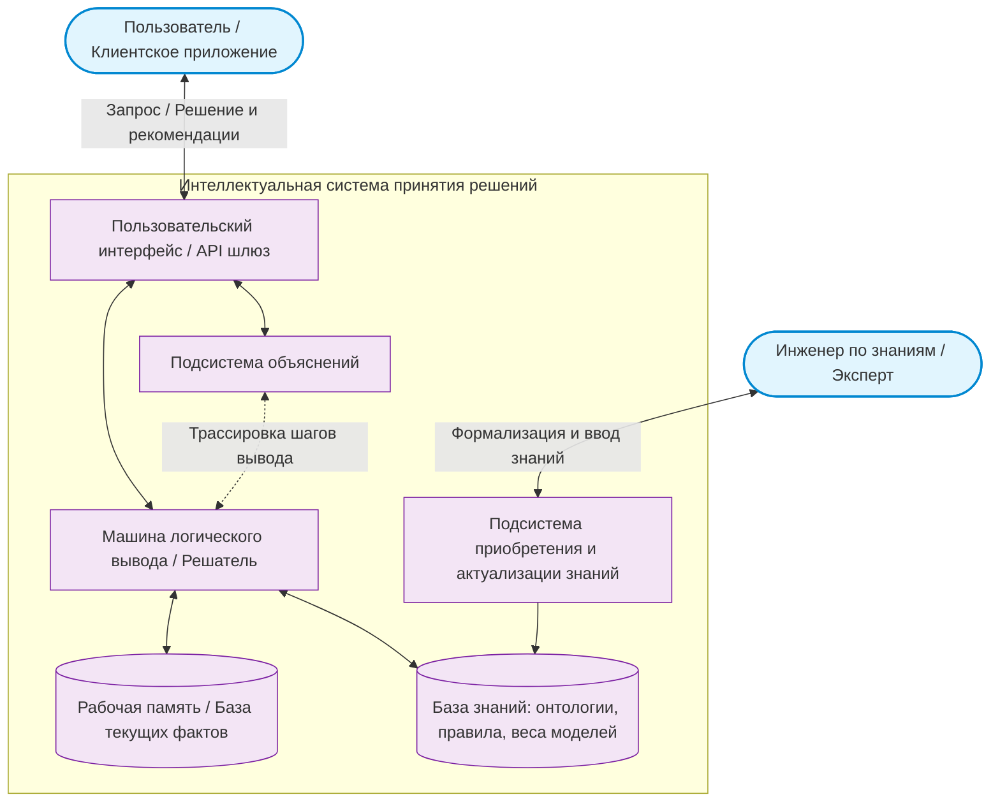

# Практическая работа № 1
## Искусственный интеллект: основные понятия и история возникновения

**Дисциплина:** Искусственный интеллект в профессиональной сфере  
**Выполнил:** студент группы ПИН-б-о-24-1(2), 3 курс  
**ФИО:** Мухамеджанов Эльёр Тимурович  
**Направление подготовки:** 09.03.03 «Прикладная информатика»  
**Профиль:** Разработка программного обеспечения и веб-систем  
**Учебное заведение:** ФГАОУ ВО «Северо-Кавказский федеральный университет»  
**Год:** 2026

---

### Цель занятия
Ознакомиться с основными понятиями искусственного интеллекта и дать общую характеристику задачам, решаемым методами искусственного интеллекта.

### Вопросы, выносимые на обсуждение
1. Основные понятия систем искусственного интеллекта.
2. Общая характеристика задач, решаемых методами искусственного интеллекта.

---

### Задание 1. Расшифровка аббревиатур из области искусственного интеллекта

| Аббревиатура | Полное наименование | Определение и назначение |
|---|---|---|
| **ИИ** | Искусственный Интеллект *(Artificial Intelligence, AI)* | Научное направление и комплекс технологических решений, имитирующих когнитивные функции человека (восприятие, рассуждение, обучение, принятие решений) для решения прикладных задач. |
| **ЭС** | Экспертная Система *(Expert System, ES)* | Интеллектуальная вычислительная система, аккумулирующая знания высококвалифицированных экспертов в узкой предметной области и способная воспроизводить процесс решения задач человеком-специалистом с выдачей логических объяснений. |
| **БЗ** | База Знаний *(Knowledge Base, KB)* | Организованная совокупность фактов, концептов, правил вывода, эвристик и онтологических связей о предметной области, представленная на формальном машинно-интерпретируемом языке. |
| **ИНС** | Искусственная Нейронная Сеть *(Artificial Neural Network, ANN)* | Вычислительная модель, инспирированная биологическими нейронными сетями мозга, представляющая собой граф связанных математических нейронов и способная решать задачи классификации, аппроксимации и прогнозирования через обучение на эмпирических данных. |
| **РП** | Рабочая Память *(Working Memory)* / Решатель Проблем *(Problem Solver)* | Динамическая область памяти интеллектуальной системы, хранящая текущие исходные факты, промежуточные состояния рассуждений и гипотезы, полученные в рамках текущей решаемой сессии. |

---

### Задание 2. Схематичное изображение компонентов Интеллектуальной системы принятия решений (ИСПР)



#### Описание взаимосвязи компонентов:
1. **Пользовательский интерфейс / API**: принимает исходные параметры задачи от внешнего пользователя или клиентского сервиса (веб-приложения) и возвращает готовое решение.
2. **Рабочая память**: содержит факты конкретной текущей сессии (например, текущие метрики сетевого соединения игрока или расклад в партии).
3. **База знаний**: долговременное хранилище абстрактных правил, закономерностей и моделей экспертов.
4. **Машина логического вывода**: применяет продукционные правила или алгоритмы поиска решений к данным из рабочей памяти, используя базу знаний.
5. **Подсистема объяснений**: обосновывает пользователю, почему система пришла к данному выводу (критично для доверия к ИИ).
6. **Подсистема приобретения знаний**: автоматизирует или облегчает инженеру по знаниям процесс пополнения и верификации базы знаний.

---

### Задание 3. Процесс добычи и обработки знаний

Процесс инженерии знаний (Knowledge Engineering & Data/Knowledge Mining) представляет собой структурированный цикл преобразования неявных знаний экспертов и сырых данных в формализованную машинную модель.

```text
+-----------------------+     +----------------------+     +-----------------------+
|  1. Идентификация     | --> |  2. Извлечение       | --> |  3. Концептуализация  |
|  проблемы и границ    |     |  знаний (интервью,   |     |  (построение          |
|  предметной области   |     |  логи, метрики)      |     |  онтологической карты)|
+-----------------------+     +----------------------+     +-----------------------+
                                                                      |
                                                                      v
+-----------------------+     +----------------------+     +-----------------------+
|  6. Сопровождение     | <-- |  5. Верификация      | <-- |  4. Формализация      |
|  и адаптация знаний   |     |  и валидация базы    |     |  (продукции, фреймы,  |
|  в рабочей среде      |     |  знаний на тестах    |     |  семантические графы) |
+-----------------------+     +----------------------+     +-----------------------+
```

1. **Идентификация:** определение класса решаемых задач, необходимых ресурсов, экспертов и критериев успешности решения.
2. **Извлечение знаний (Acquisition):**
   * *Пассивные методы:* анализ технической документации, исходного кода, сетевых логов и игровых сессий.
   * *Активные методы:* диалоги, опросы, анкетирование экспертов (геймдизайнеров, ведущих сетевых инженеров).
   * *Автоматические методы:* машинное обучение и data mining на исторических базах данных.
3. **Концептуализация:** выявление базовых понятий, атрибутов, ограничений и связей между объектами предметной области (составление глоссария и онтологии).
4. **Формализация:** выбор моделей представления знаний (продукционные правила `IF-THEN`, фреймы, байесовские сети, нечеткая логика) и запись знаний на формальном языке.
5. **Тестирование и верификация:** проверка непротиворечивости, полноты, отсутствия циклов в графе вывода и точности решений на контрольной выборке реальных ситуаций.
6. **Актуализация и сопровождение:** непрерывная калибровка весов правил по мере изменения параметров предметной области.

---

### Задание 4. Задачи из профессиональной области (09.03.03 «Прикладная информатика», мультиплеерные веб-игры), решаемые методами ИИ

В сфере проектирования и разработки программного обеспечения высоконагруженных веб-приложений и мультиплеерных браузерных игровых платформ (на примере проектов студии NecroGames) искусственный интеллект эффективно решает следующие ключевые задачи:

1. **Интеллектуальный динамический баланс сложности (Dynamic Difficulty Adjustment, DDA):**
   * *Проблема:* удержание удержания (retention) игроков с разным уровнем подготовки.
   * *Решение ИИ:* алгоритмы адаптивного подбора соперников и динамического поведения ИИ-ботов в комнатах, предотвращающие как скуку сильных игроков, так и фрустрацию новичков.
2. **Обнаружение читов, ботов и недобросовестного поведения (Anti-Cheat & Fraud Detection):**
   * *Проблема:* использование автокликеров, скриптов анализа трафика и подмены WebSocket-сообщений.
   * *Решение ИИ:* нейросетевая классификация последовательностей координат курсора мыши, таймингов кликов и аномалий в поведении игрока (с использованием LSTM / автоэнкодеров).
3. **Предиктивная компенсация сетевого лага (Client-Side Lag Prediction):**
   * *Проблема:* нестабильный пинг и джиттер у клиентов браузерных игр ухудшают плавность синхронизации.
   * *Решение ИИ:* алгоритмы машинного обучения для предсказания траекторий и действий игроков на период потери пакетов (Dead Reckoning нового поколения на базе ИНС).
4. **Процедурная генерация сбалансированного контента (PCG):**
   * *Проблема:* ручное создание и балансировка сотен игровых карт, предметов и характеристик отнимает много времени и подвержено ошибкам баланса.
   * *Решение ИИ:* применение генетических алгоритмов для синтеза колод и параметров с заданной целевой метрикой соревновательного паритета (Win Rate близкий к 50%).

---

### Задание 5. Примеры систем искусственного интеллекта

| Пример искусственного интеллекта | Область применения | Тип искусственного интеллекта |
|---|---|---|
| **Stockfish / Leela Chess Zero** | Компьютерные шахматы, стратегический анализ позиций | Гибридный ИИ: эвристический поиск $\alpha$-$\beta$ отсечением + глубокие сверточные сети с обучением с подкреплением (Deep RL) |
| **MYCIN** | Медицинская диагностика бактериальных инфекций крови | Классическая символьная продукционная экспертная система с коэффициентами уверенности (Certainty Factors) |
| **OpenAI Five / AlphaStar** | Киберспортивные мультиплеерные стратегии (Dota 2, StarCraft II) | Многоагентное глубокое обучение с подкреплением (Multi-Agent Actor-Critic Deep RL) |
| **YOLOv8 (You Only Look Once)** | Компьютерное зрение: детекция объектов в реальном времени, видеоаналитика | Глубокая сверхточная нейронная сеть (CNN) прямого распространения |
| **Климат-контроль на Fuzzy Logic** | Встраиваемые микроконтроллерные системы бытовой и автомобильной техники | Нечеткая логическая система (Fuzzy Logic Controller по модели Мамдани) |
| **Netcode Anomaly Detector (NecroGames)** | Мониторинг сетевых аномалий в веб-играх | Нечеткая экспертная система в комбинации с рекуррентной ИНС |

---

### Задание 6. Сущностные отличия задач ИИ от традиционных вычислительных задач

| Критерий сравнения | Традиционные задачи на ЭВМ | Задачи искусственного интеллекта |
|---|---|---|
| **Характер алгоритма** | Детерминированный, пошаговый, строго формализованный алгоритм, всегда приводящий к однозначному результату. | Эвристический, адаптивный; алгоритм оптимизирует функцию приспособленности или ищет правдоподобное решение в огромном пространстве состояний. |
| **Полнота и качество входных данных** | Требуются точные, полные, непротиворечивые исходные числовые или структурированные данные. | Способность эффективно работать в условиях неполноты, зашумленности, стохастичности и нечеткости информации. |
| **Форма представления информации** | Преимущественно числовые массивы, таблицы, бинарные структуры данных. | Символьные структуры, графы знаний, фреймы, эмбеддинги, концептуальные онтологии. |
| **Способность к обобщению и обучению** | Отсутствует. Программа выполняет ровно те ветвления, которые жестко заложил разработчик в исходный код. | Присутствует способность к индуктивному выводу: система обучается на примерах и способна корректно классифицировать ранее не встречавшиеся ситуации. |
| **Интерпретируемость решений** | Прямой трассировкой кода через отладчик (дебаггер). | Требуются специальные механизмы объяснения (Explainable AI, графы логического вывода, карты внимания Attention). |

---

### Вывод
В ходе практической работы № 1 изучены базовые категории искусственного интеллекта, понятийный аппарат и структурные элементы ИСПР. Продемонстрировано, что применительно к направлению «Прикладная информатика» и разработке сетевых веб-платформ методы ИИ позволяют автоматизировать класс слабоструктурированных задач (детекция аномалий, динамическая адаптация геймплея), решение которых классическими алгоритмическими методами неэффективно.
