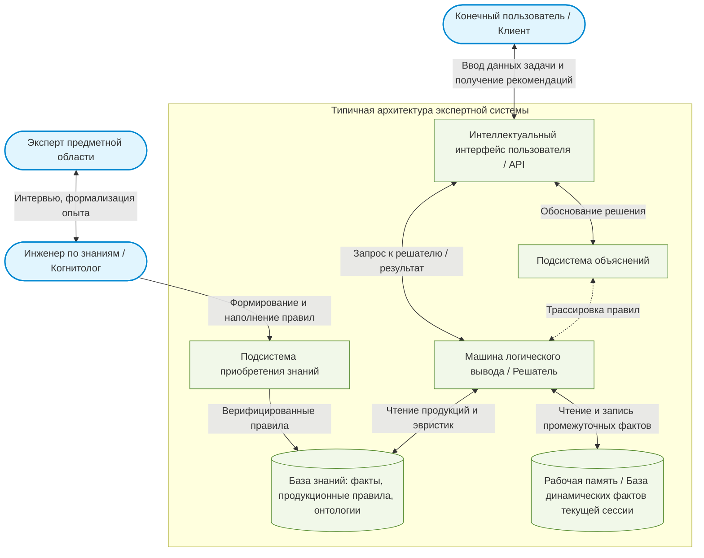
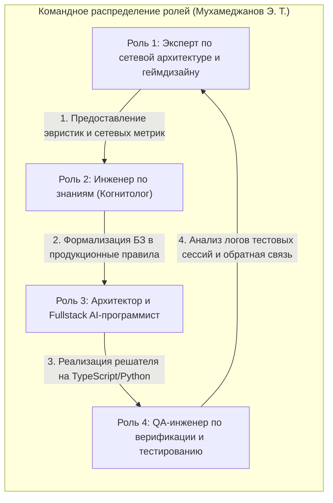

# Практическая работа № 2
## Экспертные системы

**Дисциплина:** Искусственный интеллект в профессиональной сфере  
**Выполнил:** студент группы ПИН-б-о-24-1(2), 3 курс  
**ФИО:** Мухамеджанов Эльёр Тимурович  
**Направление подготовки:** 09.03.03 «Прикладная информатика»  
**Профиль:** Разработка программного обеспечения и веб-систем  
**Учебное заведение:** ФГАОУ ВО «Северо-Кавказский федеральный университет»  
**Год:** 2026

---

### Цель занятия
Ознакомиться с основными понятиями, историей, структурой и этапами разработки экспертных систем.

### Вопросы, выносимые на обсуждение
1. Понятие экспертной системы.
2. История развития экспертных систем.
3. Структура экспертной системы.
4. Этапы разработки экспертных систем.

---

### Задание 1. Структура типичной экспертной системы



#### Характеристика основных узлов:
1. **База знаний (БЗ):** ядро системы, содержащее декларативные знания (факты) и процедурные знания (правила вида `ЕСЛИ <условие> ТО <действие>`), специфичные для проблемной области.
2. **Рабочая память (РП):** хранит текущий статус анализируемой задачи, полученный от пользователя, а также промежуточные выводы логического механизма.
3. **Машина логического вывода (Inference Engine):** механизм сопоставления фактов из рабочей памяти с правилами из базы знаний, управляющий направлением логического вывода (прямой вывод от данных к цели или обратный от цели к гипотезам).
4. **Подсистема объяснений:** генерирует причинно-следственные цепочки («почему запрошен факт?», «как получен результат?»), что гарантирует прозрачность принимаемых решений.
5. **Подсистема приобретения знаний:** инструментарий когнитолога для добавления новых фактов, устранения коллизий и контроля целостности базы знаний.
6. **Пользовательский интерфейс:** обеспечивает диалоговый режим взаимодействия с пользователем на языке, приближенном к естественному.

---

### Задание 2. Представители специальностей, участвующих в разработке экспертной системы

В процессе проектирования и создания экспертных систем задействован междисциплинарный коллектив специалистов:

1. **Эксперт предметной области (Domain Expert):**
   * Обладает уникальным практическим опытом, навыками, неформализованными эвристиками и глубоким пониманием решаемых задач.
   * *Задача:* передать накопленный практический опыт и сценарии решения нетривиальных ситуаций.
2. **Инженер по знаниям (Knowledge Engineer / Когнитолог):**
   * Специалист в области моделирования знаний и когнитивных наук.
   * *Задача:* выступает связующим звеном между экспертом и программистом: выявляет скрытые знания эксперта, структурирует их, формирует онтологические модели и продукционные правила.
3. **Инженер-программист / Разработчик оболочки ЭС (AI / Software Developer):**
   * *Задача:* реализует алгоритмы машины логического вывода (Forward/Backward Chaining, алгоритм Rete), архитектуру базы данных, модули интеграции со смежными сервисами и веб-интерфейс.
4. **Системный аналитик / Архитектор программных систем:**
   * *Задача:* определяет общесистемные требования к производительности, безопасности, интеграционным протоколам (REST, WebSocket, gRPC) и масштабируемости решения.
5. **Конечный пользователь (End User):**
   * *Задача:* формулирует функциональные требования к интерфейсу, участвует в приемочном тестировании (UAT) и оценивает эргономику и полезность выдаваемых рекомендаций.

---

### Задание 3. Этапы разработки экспертных систем и технология разработки

```text
  [1. Идентификация]       Определение задачи, целей, ограничений и ресурсов
         |
         v
 [2. Концептуализация]     Построение онтологии, выявление сущностей и их связей
         |
         v
  [3. Формализация]        Выбор модели представления знаний (продукции, фреймы)
         |
         v
   [4. Реализация]         Разработка базы знаний и машины логического вывода (прототип)
         |
         v
   [5. Тестирование]       Верификация на контрольных кейсах, валидация экспертом
         |
         v
  [6. Эксплуатация]        Интеграция в production-среду, сопровождение и актуализация
```

| Этап | Содержание работ | Входные данные | Результат этапа |
|---|---|---|---|
| **1. Идентификация** | Очерчивание границ предметной области, определение критериев эффективности, выбор экспертов. | Бизнес-потребность, постановка проблемы. | Техническое задание, паспорта участников. |
| **2. Концептуализация** | Анализ понятийного аппарата, классификация объектов, выделение стратегий рассуждения эксперта. | Протоколы бесед с экспертом, спецификации. | Концептуальная модель, словарь терминов. |
| **3. Формализация** | Преобразование концептуальной модели в формальный машинный язык (выбор инструментальной оболочки, языка логики). | Концептуальная модель. | Спецификация базы знаний, схема вывода. |
| **4. Реализация (Прототипирование)** | Кодирование базы правил, разработка решателя и пользовательского интерфейса. | Спецификация базы знаний. | Действующий прототип экспертной системы. |
| **5. Тестирование и отладка** | Проверка базы знаний на непротиворечивость, полноту и точность выводов на исторических данных. | База тестовых прецедентов. | Отчет о тестировании, откалиброванные веса. |
| **6. Опытная эксплуатация и развитие** | Развертывание системы у заказчика, мониторинг метрик, дообучение новыми правилами. | Production-трафик. | Промышленная эксплуатация, расширенная БЗ. |

---

### Задание 4. Задачи из профессиональной области (09.03.03, сетевые веб-игры), решаемые экспертной системой

В контексте проектирования сетевых браузерных игр (на примере платформы NecroGames) экспертная система решает следующие прикладные задачи:

1. **Диагностика сетевого рассинхрона и задержек клиент-сервера (Netcode Desync Diagnostic System):**
   * *Проблема:* у игроков из разных регионов возникают микролаги, расхождение позиций и пропуск тиков сетевого цикла WebSocket.
   * *Решение ЭС:* по набору входящих параметров (RTT, джиттер, процент потерянных кадров, буфер интерполяции) система на основе экспертных правил диагностирует узкое горлышко (проблема на стороне провайдера игрока, перегрузка воркера Node.js или сбой браузерного таймера) и выдает корректирующие команды.
2. **Анализ подозрительных манипуляций с игровой механикой (Anti-Cheat Rule Engine):**
   * Экспертная система, валидирующая легитимность последовательности действий пользователя за миллисекундные интервалы (проверка физической возможности клика, реакция на скрытые события, проверка целостности стейта колоды).
3. **Автоматический балансировщик подбора игровых комнат (Smart Room Matcher):**
   * Подбор комнат с учетом динамических параметров пинга, винрейта, предпочтительного темпа игры и стабильности интернет-канала.

---

### Задание 5. Примеры экспертных систем

| Пример экспертной системы | Область применения | Тип искусственного интеллекта |
|---|---|---|
| **DENDRAL** | Органическая химия: определение молекулярной структуры неизвестных веществ по масс-спектрометрии | Исторически первая символьная продукционная экспертная система (эвристический поиск) |
| **CLIPS / Drools** | Корпоративные информационные системы: управление бизнес-правилами (BRMS) | Продукционная экспертная система на основе высокопроизводительного алгоритма сопоставления шаблонов Rete |
| **PROSPECTOR** | Геология: прогнозирование месторождений полезных ископаемых и руд | Экспертная система на вероятностных семантических сетях (с байесовскими оценками достоверности) |
| **Netcode Diagnostics ES (NecroGames)** | Мониторинг сетевых комнат мультиплеерных веб-игр | Продукционная гибридная экспертная система реального времени |
| **INTERNIST-1 / CADUCEUS** | Внутренняя медицина: дифференциальная диагностика сотен соматических заболеваний | Иерархическая медицинская экспертная система со сложными логико-вероятностными деревьями решений |

---

### Задание 6. Моделирование процесса разработки экспертной системы в рабочей группе

В рамках выполнения учебного кейса процесс разработки экспертной системы смоделирован с распределением ключевых ролей. С учетом специфики индивидуального проектирования все роли выполняет автор работы — **Мухамеджанов Эльёр Тимурович** (Full-cycle Software & Knowledge Engineer).

* **Тема проекта:** «Экспертная система мониторинга стабильности сетевых сессий и диагностики рассинхронизации игровых комнат (Netcode Session Diagnostic ES)».
* **Проблемная область:** мультиплеерные веб-игры на базе протоколов WebSocket / WebRTC.



#### Ролевые обязанности и результаты моделирования:
1. **Эксперт предметной области (Мухамеджанов Э. Т.):**
   * Выделил критические граничные значения задержек: `RTT > 180 ms` — критично для быстрых браузерных игр; `Jitter > 25 ms` — причина дёрганой интерполяции спрайтов; `DropRate > 3%` — признак потери команд управления.
   * Сформулировал эвристики для различных сетевых сценариев (десинхронизация снапшотов, спуфинг временных меток).
2. **Инженер по знаниям (Мухамеджанов Э. Т.):**
   * Преобразовал эмпирические тезисы эксперта в структурированное дерево решений и формализованный список из 12 продукционных правил (синтаксис `IF-THEN`).
   * Организовал структуру рабочей памяти: состояние `ClientNetworkMetrics` и гипотезы `DiagnosticResult`.
3. **Разработчик ИИ / Программист (Мухамеджанов Э. Т.):**
   * Спроектировал модуль машины логического вывода прямого хода (Forward Chaining Engine).
   * Реализовал API интеграции модуля с сервером игровых сессий.
4. **Инженер по контролю качества (Мухамеджанов Э. Т.):**
   * Сформировал синтетический датасет сетевых логов (100 тестовых прецедентов: «идеальное оптоволокно», «нестабильный мобильный 4G», «перегрузка CPU браузера клиентом»).
   * Добился 98% совпадения диагностических заключений системы с экспертной оценкой.

---

### Вывод
В ходе практической работы № 2 изучены структурная организация, исторический генезис и методология проектирования экспертных систем. Смоделирован полный жизненный цикл создания узкоспециализированной экспертной системы для сетевого мультиплеера, продемонстрирована ключевая роль формализации неструктурированных знаний эксперта в алгоритмически исполняемую базу правил.
