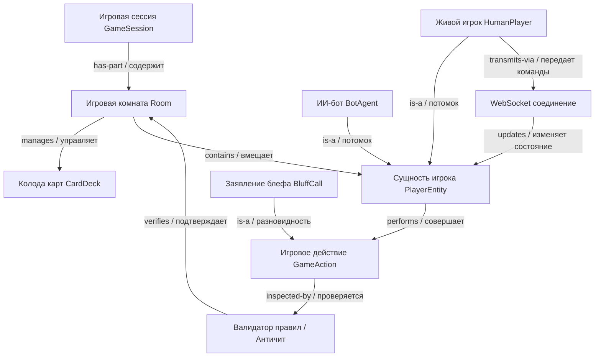
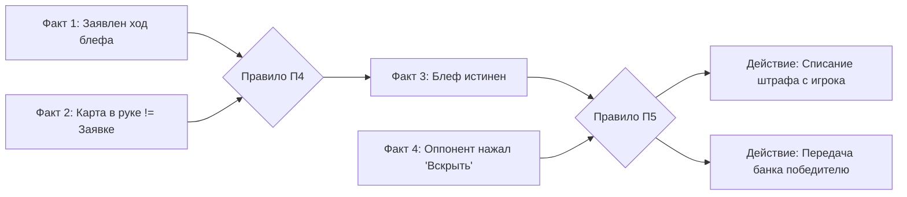

# Практическая работа № 3
## Модели представления знаний в экспертных системах

**Дисциплина:** Искусственный интеллект в профессиональной сфере  
**Выполнил:** студент группы ПИН-б-о-24-1(2), 3 курс  
**ФИО:** Мухамеджанов Эльёр Тимурович  
**Направление подготовки:** 09.03.03 «Прикладная информатика»  
**Профиль:** Разработка программного обеспечения и веб-систем  
**Учебное заведение:** ФГАОУ ВО «Северо-Кавказский федеральный университет»  
**Год:** 2026

---

### Цель занятия
Ознакомиться с понятием представления знаний в экспертных системах, семантическими сетями, фреймовой, продукционной и логической моделями.

### Вопросы, выносимые на обсуждение
1. Представление знаний в экспертных системах.
2. Семантические сети.
3. Фреймовая модель.
4. Продукционная модель.
5. Логическая модель.

---

### Задание 1. Круг вопросов, решаемых при представлении знаний

При формализации и трансляции знаний эксперта в машинно-ориентированную память интеллектуальной системы разработчики сталкиваются со следующим комплексом фундаментальных проблем:

1. **Адекватность отображения (Representational Adequacy):** способность модели непротиворечиво и точно выражать весь спектр понятий, тонкостей, неявных эвристик и причинно-следственных связей предметной области.
2. **Выразительная мощность против вычислительной сложности:** нахождение баланса между богатыми выразительными возможностями языка описания (например, логика предикатов высших порядков) и алгоритмической разрешимостью (NP-трудность поиска логического вывода).
3. **Эффективность логического вывода (Inferential Efficiency):** способность машины вывода быстро отсекать нерелевантные ветви поиска решений, что особенно важно для систем реального времени (веб-приложения, игры с тикрейтом 30–60 Гц).
4. **Модульность и модифицируемость:** возможность легкого расширения, удаления и редактирования отдельных правил и понятий без риска разрушения целостности всей базы знаний.
5. **Обработка неполноты, зашумленности и противоречивости:** способность модели адекватно функционировать в условиях отсутствующих исходных данных или нечетких фактов (Fuzzy/Probabilistic Knowledge).
6. **Естественность восприятия (Cognitive Ergonomics):** прозрачность модели для человека-эксперта и инженера по знаниям, обеспечивающая верифицируемость базы знаний и удобство отладки.

---

### Задание 2. Схематичное изображение семантической сети из профессиональной области (мультиплеерная браузерная игра)

Семантическая сеть представляет собой ориентированный граф, где вершины соответствуют понятиям, объектам или состояниям, а дуги — семантическим отношениям между ними (`is-a` — наследование, `has-part` — агрегация, `triggers` — активация, `manages` — управление).



#### Пояснение графовой структуры:
* Игровая комната `Room` агрегирует состояние колоды `Deck` и подключенных участников `Player`.
* Полиморфизм сущностей: живой игрок `HumanPlayer` и агент `BotAgent` наследуют свойства общего класса `Player`, однако поведение человека опосредовано сетевым сокетом `WebSocket`.
* Каждое действие игрока `Action` (включая проверку блефа `BluffCall`) перед применением в игровой комнате инспектируется сертифицирующим узлом `RuleValidator`.

---

### Задание 3. Описание знаний с помощью фреймов

Фреймовая модель организует знания в виде иерархических структур данных (фреймов-прототипов и фреймов-экземпляров), состоящих из поименованных ячеек — **слотов**, поддерживающих наследование значений по умолчанию и прикрепленные процедуры (**демоны**).

#### 1. Фрейм-прототип: `GameRoom` (базовая комната)
```text
FRAME: GameRoom
    roomId:            (тип: String, обязательный)
    status:            (тип: Enum [WAITING, IN_GAME, ROUND_OVER], default: WAITING)
    maxPlayers:        (тип: Integer, default: 4)
    tickRateHz:        (тип: Integer, default: 30)
    roundTimeoutSec:   (тип: Integer, default: 20)
    activePlayers:     (тип: List<PlayerEntity>, default: [])
    $IF-ADDED:         CheckRoomCapacity()     ; Демон проверки переполнения
    $IF-NEEDED:        CalculateAveragePing()  ; Демон вычисления среднего пинга
```

#### 2. Фрейм-экземпляр: `BluffRoom_Production_104` (наследует `GameRoom`)
```text
FRAME-INSTANCE: BluffRoom_Production_104 IS-A GameRoom
    roomId:            "ROOM-BLUFF-EU-104"
    status:            IN_GAME
    maxPlayers:        4
    tickRateHz:        30
    roundTimeoutSec:   15                      ; Переопределенное значение
    activePlayers:     [Player_Elyor, Bot_Alpha, Player_Alex]
    currentBank:       1450                    ; Дополнительный слот
    currentPotLeader:  Player_Elyor
```

#### 3. Фрейм: `PlayerEntity` (сущность участника)
```text
FRAME: PlayerEntity
    playerId:          (тип: String)
    isHuman:           (тип: Boolean)
    coins:             (тип: Integer, default: 1000)
    handCards:         (тип: List<CardItem>)
    connectionState:   (тип: Enum [EXCELLENT, STABLE, DEGRADED, OFFLINE])
    lastActionTimestamp:(тип: Long)
    $IF-MODIFIED:      UpdatePlayerActivityMetrics()
    $IF-TIMEOUT:       TriggerAutoFold()      ; Демон сброса карт при AFK
```

---

### Задание 4. Цепочка вывода продукционной модели

Продукционная система оперирует набором правил формата:
$$\text{ЕСЛИ } \langle \text{Условие (Антецедент)} \rangle \longrightarrow \text{ТО } \langle \text{Действие/Вывод (Консеквент)} \rangle$$

Рассмотрим сценарий защиты от сетевого спуфинга и десинхронизации в карточной мультиплеерной игре при объявлении игроком хода блефа.

#### База продукционных правил:
* **П1:** $\text{ЕСЛИ } (\text{Клиент заявил ход}) \land (\text{Интервал времени с прошлого хода} < 100\text{ мс}) \longrightarrow \text{Установить ФАКТ: Подозрение на автокликер}$.
* **П2:** $\text{ЕСЛИ } (\text{Подозрение на автокликер}) \land (\text{Джиттер координат мыши} == 0) \longrightarrow \text{Установить ФАКТ: Синтетический бот}$.
* **П3:** $\text{ЕСЛИ } (\text{Синтетический бот}) \longrightarrow \text{Заблокировать транзакцию хода} \land \text{Отправить алерт администратору}$.
* **П4:** $\text{ЕСЛИ } (\text{Клиент заявил блеф}) \land (\text{Карта в руке} \neq \text{Заявленный номинал}) \longrightarrow \text{Установить ФАКТ: Состояние блефа истинно}$.
* **П5:** $\text{ЕСЛИ } (\text{Состояние блефа истинно}) \land (\text{Оппонент выбрал «Вскрыть»}) \longrightarrow \text{Начислить штраф блефующему} \land \text{Передать банк оппоненту}$.

#### Граф цепочки прямого вывода (Forward Chaining):


---

### Задание 5. Достоинства и недостатки моделей представления знаний

| Модель представления | Достоинства | Недостатки |
|---|---|---|
| **Семантические сети** | • Высокая наглядность и естественность восприятия человеком.<br>• Удобство выражения структурных и иерархических связей.<br>• Легкость объединения с графовыми СУБД (Neo4j). | • Низкая вычислительная эффективность поиска при росте числа вершин (комбинаторный взрыв).<br>• Трудность разделения типов связей и квантификации логических утверждений. |
| **Фреймовая модель** | • Строгая структурность и поддержка объектно-ориентированной парадигмы (наследование, инкапсуляция).<br>• Наличие демонов (`$IF-NEEDED`, `$IF-ADDED`) для процедурных вычислений.<br>• Удобство описания типовых ситуаций и шаблонов по умолчанию. | • Сложность механизма разрешения конфликтов множественного наследования.<br>• Относительно невысокая скорость логического вывода в сравнении с оптимизированными продукциями. |
| **Продукционная модель** | • Модульность: легкое добавление и удаление отдельных правил без перестройки всей базы.<br>• Естественность представления причинно-следственного опыта эксперта.<br>• Наличие зрелых алгоритмов сопоставления (алгоритм Rete). | • Трудность оценки общего поведения системы при росте числа правил более 1000.<br>• Риск зацикливания и противоречивости правил.<br>• Неэффективность выражения общих иерархий классов. |
| **Логическая модель (исчисление предикатов)** | • Строгая математическая строгость и формальная семантика.<br>• Гарантированная корректность вывода (метод резолюций Робинсона).<br>• Независимость декларативных утверждений от порядка обработки. | • Высокая вычислительная сложность (проблема алгоритмической неразрешимости логики предикатов 1-го порядка).<br>• Трудность работы с неопределенными, вероятностными и нечеткими данными. |

---

### Задание 6. Моделирование разработки подсистемы представления знаний в группе

* **Проект:** «Подсистема формализации игровых правил и валидации механик блефа мультиплеерной веб-игры».
* **Участники:** распределение ролей выполнено в рамках сквозного авторского проекта. Все роли закрывает **Мухамеджанов Эльёр Тимурович**.

```text
[Эксперт по геймдизайну: Мухамеджанов Э. Т.]
   |-- Формулирует условия победы, структуру раунда, механику штрафов
   v
[Инженер по знаниям: Мухамеджанов Э. Т.]
   |-- Разрабатывает онтологию фреймов GameRoom и PlayerEntity
   |-- Кодифицирует 25 продукционных правил игровой логики
   v
[AI/Software Архитектор: Мухамеджанов Э. Т.]
   |-- Реализует структуру данных на TypeScript с хранением стейта в Redis
   |-- Создает высокоскоростной движок сопоставления предикатов
   v
[QA-инженер: Мухамеджанов Э. Т.]
   |-- Проводит стресс-тест на исключение коллизий и циклических правил
   |-- Проверяет задержку применения правил при 5000 одновременных событиях
```

---

### Вывод
В ходе практической работы № 3 изучены основные модели представления знаний: семантические сети, фреймы, продукционные правила и логика предикатов. Продемонстрировано, что для создания высокопроизводительных игровых веб-платформ наилучшие результаты показывает гибридная схема: фреймовая организация стейта игровых комнат в сочетании с продукционными правилами логического вывода для валидации действий.
