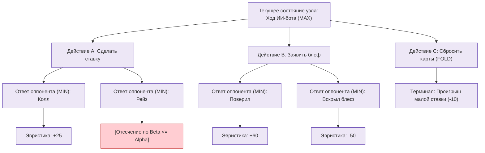
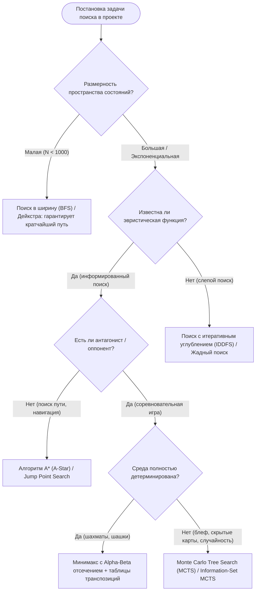

# Практическая работа № 4
## Модели поиска решений в экспертных системах

**Дисциплина:** Искусственный интеллект в профессиональной сфере  
**Выполнил:** студент группы ПИН-б-о-24-1(2), 3 курс  
**ФИО:** Мухамеджанов Эльёр Тимурович  
**Направление подготовки:** 09.03.03 «Прикладная информатика»  
**Профиль:** Разработка программного обеспечения и веб-систем  
**Учебное заведение:** ФГАОУ ВО «Северо-Кавказский федеральный университет»  
**Год:** 2026

---

### Цель занятия
Ознакомиться с основными методами поиска решений в экспертных системах.

### Вопросы, выносимые на обсуждение
1. Методы поиска решений.
2. Поиск решений в одном пространстве.
3. Поиск решений в иерархии пространств.
4. Поиск в альтернативных пространствах.
5. Поиск с использованием нескольких моделей.
6. Выбор метода поиска решений.

---

### Задание 1. Особенности предметной области (мультиплеерные браузерные игры)

| Особенность предметной области | Описание применительно к профессиональной сфере (09.03.03 / сетевой геймдев) |
|---|---|
| **Объем пространства, в котором предстоит искать решение** | **Экспоненциально большой (NP-сложный):** пространство состояний карточной партии или тактического поля растет как $b^d$, где $b$ — фактор ветвления (количество доступных карт, ставок и блеф-заявлений, $b \approx 5..20$), а $d$ — глубина раунда ($d \approx 10..30$). Полный перебор состояний невозможен за время тика сервера. |
| **Степень изменяемости области во времени и пространстве** | **Высокодинамическая непрерывная область:** состояние комнат меняется асинхронно в реальном времени под действием действий живых игроков по WebSocket, сетевых задержек (джиттер, лаги) и таймеров обратного отсчета хода. Решение, вычисленное секунду назад, может стать невалидным. |
| **Полнота модели, описывающей область** | **Неполная (частично наблюдаемая среда):** агент ИИ не видит закрытые карты соперников и не знает их истинных психологических намерений. Для адекватного моделирования используется ансамбль дополняющих моделей: вероятностная оценка скрытых карт + теория игр + эвристический поиск по дереву решений. |
| **Определенность данных о решаемой задаче (точность и полнота)** | **Стохастическая, зашумленная и неполная:** присутствуют сетевые потери пакетов, непредсказуемый человеческий фактор блефа, псевдослучайная генерация сида колоды. Алгоритм обязан оперировать нечеткими распределениями вероятностей исходов. |

---

### Задание 2. Требования пользователя к результату задачи поиска

В контексте поиска оптимального действия игрового бота или подбора сетевого маршрута для комнаты:

| Параметр требования | Критерий и метрика | Обоснование требования |
|---|---|---|
| **Время отклика (Latency/SLA)** | $\le 50..100 \text{ мс}$ | В браузере игрок не должен замечать подвисаний сервера. Задержка ИИ свыше 200 мс разрушает динамику и погружение. |
| **Субоптимальность решения** | Не ниже 85% от глобально оптимального | Допустимо пожертвовать идеальной математической точностью ради жесткого соблюдения тайминга ответа бота. |
| **Правдоподобность поведения (Human-like)** | Оценка теста Тьюринга в игре | Решение бота не должно выглядеть роботизированным перебором; оно должно содержать элементы реалистичного риска и психологического блефа. |
| **Устойчивость к неполным данным** | 100% работоспособность при потере части телеметрии | При выпадении WebSocket пакета алгоритм поиска должен корректно использовать экстраполированные данные (fallback-эвристику). |
| **Ресурсоемкость памяти** | Не более $64 \text{ МБ}$ на один игровой инстанс | На одном сервере Node.js одновременно обслуживаются сотни комнат, утечки дерева поиска недопустимы. |

---

### Задание 3. Алгоритм поиска решений в одном пространстве

Для выбора оптимального хода ИИ-бота в условиях частичной информированности разработан **алгоритм минимакса с эвристическим $\alpha$-$\beta$ отсечением и Монте-Карло оценкой терминальных узлов (Heuristic Alpha-Beta Minimax with Information Set Abstraction)**.



#### Листинг псевдокода алгоритма:
```text
ФУНКЦИЯ AlphaBetaSearch(state, depth, alpha, beta, isMaximizingPlayer):
    ЕСЛИ depth == 0 ИЛИ IsTerminal(state) ТО:
        ВОЗВРАТ EvaluateHeuristicState(state)  // Оценка банка, силы карт и шансов

    ЕСЛИ isMaximizingPlayer ТО:
        maxEval = -БЕСКОНЕЧНОСТЬ
        ДЛЯ КАЖДОГО action В GetValidActions(state) ВЫПОЛНИТЬ:
            childState = ApplyAction(state, action)
            eval = AlphaBetaSearch(childState, depth - 1, alpha, beta, ЛОЖЬ)
            maxEval = MAX(maxEval, eval)
            alpha = MAX(alpha, eval)
            ЕСЛИ beta <= alpha ТО:
                ПРЕРВАТЬ  // Бета-отсечение (ветвь заведомо хуже для соперника)
        ВОЗВРАТ maxEval
    ИНАЧЕ:
        minEval = +БЕСКОНЕЧНОСТЬ
        ДЛЯ КАЖДОГО action В GetOpponentLikelyActions(state) ВЫПОЛНИТЬ:
            childState = ApplyAction(state, action)
            eval = AlphaBetaSearch(childState, depth - 1, alpha, beta, ИСТИНА)
            minEval = MIN(minEval, eval)
            beta = MIN(beta, eval)
            ЕСЛИ beta <= alpha ТО:
                ПРЕРВАТЬ  // Альфа-отсечение
        ВОЗВРАТ minEval
```

---

### Задание 4. Алгоритм выбора метода поиска решений



#### Правила выбора для веб-игр:
1. Для задач навигации ботов по локациям используется **A*** с манхэттенской эвристикой.
2. Для подбора оптимальных ходов в соревновательных карточных играх с блефом применяется **MCTS** с ограничением по времени выполнения (Time-budgeted Search, 80 мс).

---

### Задание 5. Сравнение методов поиска решений

| Метод поиска | Достоинства | Недостатки |
|---|---|---|
| **Поиск в ширину (BFS)** | • Гарантирует нахождение кратчайшего пути.<br>• Полный (всегда находит решение, если оно существует). | • Экспоненциальное потребление оперативной памяти $O(b^d)$.<br>• Неприменим при факторе ветвления $> 10$. |
| **Поиск в глубину (DFS)** | • Минимальные требования к памяти $O(b \cdot d)$.<br>• Быстро находит глубокие решения в благоприятных графах. | • Не гарантирует оптимальности пути.<br>• Риск зацикливания в бесконечных ветвях без контроля посещенных узлов. |
| **Алгоритм $A^*$ (A-Star)** | • Оптимален и эффективен при монотонной (допустимой) эвристике.<br>• Исследует минимально возможное число узлов среди информированных алгоритмов. | • Большой расход памяти на хранение списков `OPEN` и `CLOSED`.<br>• Чувствителен к качеству эвристической функции $h(n)$. |
| **Minimax с $\alpha$-$\beta$ отсечением** | • Сокращает число анализируемых узлов до $O(b^{d/2})$ в лучшем случае.<br>• Математически гарантирует выигрышную стратегию в играх с нулевой суммой. | • Рассчитан преимущественно на игры с полной информацией.<br>• Вычислительно дорог при большой глубине анализа. |
| **Monte Carlo Tree Search (MCTS)** | • Не требует ручного составления эвристической оценочной функции.<br>• Идеально работает в условиях неполной информации и случайности. | • Требует запуска большого числа симуляций (rollouts).<br>• Может давать стохастический разброс решений при малом времени раздумий. |

---

### Задание 6. Моделирование процесса разработки поиска решений

* **Кейс:** «Разработка алгоритма принятия тактических решений для карточного бота в игре с механикой блефа (NecroGames)».
* **Исполнитель всех ролей:** **Мухамеджанов Эльёр Тимурович**.

```text
[Геймдизайнер / Эксперт: Мухамеджанов Э. Т.]
   |-- Формулирует весовые коэффициенты эвристики: ценность фишек, вероятность вскрытия
   v
[Инженер по знаниям: Мухамеджанов Э. Т.]
   |-- Выбирает модель пространства состояний: дерево игры с неполной информацией (Information Set)
   v
[AI Разработчик: Мухамеджанов Э. Т.]
   |-- Реализует ограниченный по времени MCTS на TypeScript с асинхронным циклом Node.js
   v
[QA Аналитик: Мухамеджанов Э. Т.]
   |-- Запускает автотурнир (10 000 партий бота против случайных игроков и эвристических ботов)
   |-- Фиксирует винрейт на уровне 58.4% при среднем времени обдумывания хода 42 мс.
```

---

### Вывод
В ходе практической работы № 4 проанализированы методы поиска решений в различных пространствах состояний. Выявлено, что специфика веб-приложений реального времени накладывает жесткие временные лимиты ($< 100\text{ мс}$), вследствие чего классические методы слепого поиска уступают эвристическим алгоритмам с ранним отсечением ветвей и симуляциям Монте-Карло.
