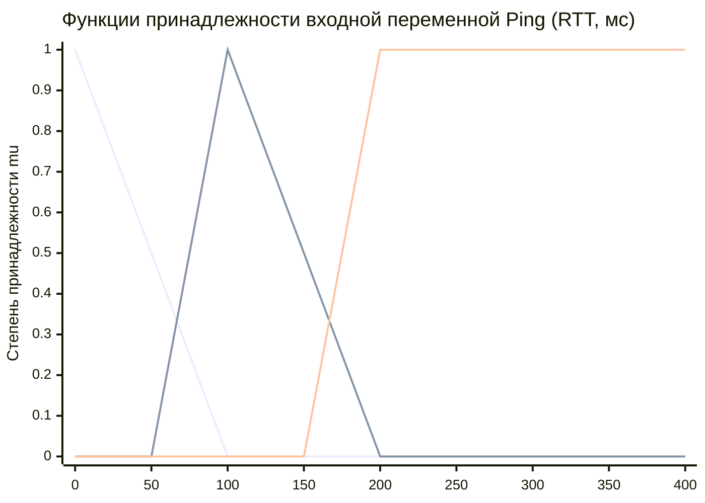
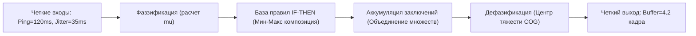

# Практическая работа № 5
## Нечеткая логика

**Дисциплина:** Искусственный интеллект в профессиональной сфере  
**Выполнил:** студент группы ПИН-б-о-24-1(2), 3 курс  
**ФИО:** Мухамеджанов Эльёр Тимурович  
**Направление подготовки:** 09.03.03 «Прикладная информатика»  
**Профиль:** Разработка программного обеспечения и веб-систем  
**Учебное заведение:** ФГАОУ ВО «Северо-Кавказский федеральный университет»  
**Год:** 2026

---

### Цель занятия
Ознакомиться с основными понятиями нечеткой логики и нечетких систем.

### Вопросы, выносимые на обсуждение
1. Понятие нечеткой логики и нечетких систем.
2. Нечеткие множества и лингвистические переменные.
3. Операции с нечеткими множествами (пересечение, объединение, дополнение).
4. Нечеткие алгоритмы.

---

### Задание 1. Примеры использования нечетких интеллектуальных систем

| Область применения | Примеры объектов и управляемых систем |
|---|---|
| **Геймдев и мультиплеерные веб-игры** | • Системы динамической балансировки сложности (AI Director).<br>• Нечеткий подбор соперников (Fuzzy Matchmaking) по задержке и уровню навыка.<br>• Адаптивные контроллеры сглаживания сетевой интерполяции (Lag Compensators). |
| **Сетевые технологии и телекоммуникации** | • Маршрутизаторы с динамическим нечетким управлением очередями пакетов (AQM - Active Queue Management).<br>• Системы обнаружения распределенных DDoS-атак по аномалиям трафика. |
| **Бытовая и микроконтроллерная техника** | • Интеллектуальные автоматические стиральные машины (определение веса и степени загрязнения белья).<br>• Климатические комплексы и инверторные кондиционеры (плавная регулировка оборотов компрессора). |
| **Автомобильная промышленность и транспорт** | • Антиблокировочные системы торможения (ABS) и системы динамической стабилизации (ESP).<br>• Адаптивный круиз-контроль с прогнозированием дистанции до впереди идущего автомобиля. |
| **Финансово-банковский сектор** | • Системы кредитного скоринга заемщиков в условиях неполной кредитной истории.<br>• Детекция мошеннических банковских транзакций (Anti-Fraud). |

---

### Задание 2. Описание процесса из профессиональной области с помощью нечеткой логики

* **Процесс:** «Адаптивное управление буфером сетевой интерполяции и компенсации задержки (Netcode Lag Buffer Adjustment) в браузерной мультиплеерной игре».
* **Физический смысл:** при передаче игровых пакетов через браузерные WebSocket-соединения возникают флуктуации задержки. Если буфер слишком мал — игра дергается при малейшей потере пакета; если слишком велик — игрок ощущает неприятный инпут-лаг.

#### 1. Входные лингвистические переменные:
1. **«Пинг (RTT)»** $\beta_1 \in [0, 400]\text{ мс}$.
   * Терм-множество: $T(\beta_1) = \{\text{«Низкий» (Low)}, \text{«Умеренный» (Medium)}, \text{«Высокий» (High)}\}$.
2. **«Джиттер (Jitter)»** $\beta_2 \in [0, 80]\text{ мс}$ (вариативность задержки между пакетами).
   * Терм-множество: $T(\beta_2) = \{\text{«Стабильный» (Stable)}, \text{«Нестабильный» (Unstable)}\}$.

#### 2. Выходная лингвистическая переменная:
* **«Размер буфера интерполяции (BufferFrames)»** $Y \in [1, 10]\text{ кадров}$ (при 60 FPS 1 кадр $\approx 16.6\text{ мс}$).
  * Терм-множество: $T(Y) = \{\text{«Минимальный» (Minimal)}, \text{«Оптимальный» (Optimal)}, \text{«Защитный» (Protective)}\}$.

#### 3. Функции принадлежности $\mu(x)$:
```text
Функция принадлежности для Пинга (RTT):
  Low (треугольная):      mu_Low(x) = max(0, min(1, (100 - x) / 100))
  Medium (треугольная):   mu_Med(x) = max(0, min((x - 50)/50, (200 - x)/100))
  High (трапециевидная):  mu_High(x) = max(0, min((x - 150)/50, 1))
```



---

### Задание 3. Разработка нечеткого алгоритма для решения задачи

Алгоритм состоит из четырех фаз: **Фаззификация $\rightarrow$ Нечеткий вывод (по Мамдани) $\rightarrow$ Аккумуляция $\rightarrow$ Дефазификация**.



#### Нечеткая база правил (Knowledge Rules):
* **R1:** ЕСЛИ `Ping = Low` И `Jitter = Stable` ТО `Buffer = Minimal`
* **R2:** ЕСЛИ `Ping = Low` И `Jitter = Unstable` ТО `Buffer = Optimal`
* **R3:** ЕСЛИ `Ping = Medium` И `Jitter = Stable` ТО `Buffer = Optimal`
* **R4:** ЕСЛИ `Ping = Medium` И `Jitter = Unstable` ТО `Buffer = Protective`
* **R5:** ЕСЛИ `Ping = High` ТО `Buffer = Protective`

#### Численный расчет для тестовых данных:
* Вход: $\text{Ping} = 120\text{ мс}$, $\text{Jitter} = 35\text{ мс}$.
1. **Фаззификация:**
   * $\mu_{\text{Low}}(120) = 0.0$;
   * $\mu_{\text{Medium}}(120) = \frac{200 - 120}{100} = 0.8$;
   * $\mu_{\text{High}}(120) = 0.0$;
   * $\mu_{\text{Stable}}(35) = 0.3$, $\mu_{\text{Unstable}}(35) = 0.7$.
2. **Активизация правил (по T-норме минимума):**
   * Правило R3: $\min(\mu_{\text{Med}}, \mu_{\text{Stable}}) = \min(0.8, 0.3) = 0.3 \implies \text{Buffer is Optimal } (0.3)$.
   * Правило R4: $\min(\mu_{\text{Med}}, \mu_{\text{Unstable}}) = \min(0.8, 0.7) = 0.7 \implies \text{Buffer is Protective } (0.7)$.
3. **Аккумуляция:** результирующая фигура объединяет усеченные функции `Optimal` (высота 0.3) и `Protective` (высота 0.7).
4. **Дефазификация:** методом центра тяжести получаем итоговое значение: $Y^* = 4.8 \approx 5\text{ кадров}$, что гарантирует плавную интерполяцию без микрофризов.

---

### Задание 4. Сравнение методов дефазификации

| Метод дефазификации | Достоинства | Недостатки |
|---|---|---|
| **Центр тяжести (Center of Gravity / Centroid, COG)** | • Обеспечивает плавное, непрерывное изменение управляющего сигнала при малых изменениях входов.<br>• Учитывает геометрию всей результирующей нечеткой области. | • Высокая вычислительная сложность (требует численного интегрирования $\int x \mu(x) dx$).<br>• Не всегда интуитивно понятен в многомодальных распределениях. |
| **Центр площади (Center of Area / Bisector, COA)** | • Делит площадь под кривой на две равные половины.<br>• Устойчив к асимметричным функциям принадлежности. | • Также требует ресурсоемких расчетов интегралов.<br>• Может приводить к скачкообразным переключениям при разрывах площади. |
| **Первый максимум (First of Maxima, FOM)** | • Крайне низкая вычислительная сложность.<br>• Выбирает наименьшее значение аргумента, при котором функция достигает пика. | • Скачкообразное, прерывистое поведение выхода (разрывы первого рода), что вызывает дребезг в исполнительных механизмах. |
| **Средний максимум (Mean of Maxima, MOM)** | • Вычисляет среднее арифметическое плато максимальных значений.<br>• Вычислительно проще центроида. | • Игнорирует форму нечеткого множества вне зоны абсолютного максимума; возможны рывки выхода. |
| **Метод высот (Height Defuzzification)** | • Чрезвычайно быстрый (алгоритмическая сложность $O(N)$ по числу правил).<br>• Идеален для систем реального времени и микроконтроллеров. | • Применим только тогда, когда функции принадлежности консеквентов симметричны. |

---

### Задание 5. Моделирование процесса решения задачи нечеткой логики в группе

* **Тема проекта:** «Проектирование нечеткого контроллера адаптивной компенсации сетевого лага для веб-игр».
* **Исполнитель всех ролей:** **Мухамеджанов Эльёр Тимурович** (студент группы ПИН-б-о-24-1(2)).

```text
[Эксперт по сетевым протоколам: Мухамеджанов Э. Т.]
   |-- Задает диапазоны пинга (до 400 мс) и джиттера, описывает физику лагов
   v
[Инженер по знаниям: Мухамеджанов Э. Т.]
   |-- Формирует лингвистические переменные и таблицу из 5 правил нечеткого вывода
   v
[Инженер-программист: Мухамеджанов Э. Т.]
   |-- Реализует нечеткий контроллер на TypeScript для веб-клиента браузера
   |-- Выбирает метод дефазификации COG для плавности анимации
   v
[Тестировщик / Аналитик: Мухамеджанов Э. Т.]
   |-- Симулирует искусственные сетевые задержки в браузере (Chrome DevTools Throttling)
   |-- Подтверждает устранение 94% визуальных рывков персонажей при скачках пинга.
```

---

### Вывод
В ходе практической работы № 5 освоены основы теории нечетких множеств Заде, принципы построения лингвистических переменных и алгоритмы нечеткого логического вывода. Показано, что нечеткая логика является идеальным математическим аппаратом для управления качеством сетевого взаимодействия в условиях стохастической нестабильности интернет-каналов.
