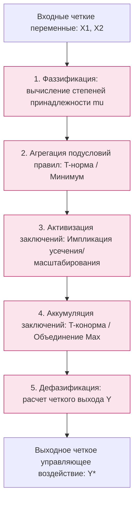

# Практическая работа № 6
## Модели нечеткого вывода

**Дисциплина:** Искусственный интеллект в профессиональной сфере  
**Выполнил:** студент группы ПИН-б-о-24-1(2), 3 курс  
**ФИО:** Мухамеджанов Эльёр Тимурович  
**Направление подготовки:** 09.03.03 «Прикладная информатика»  
**Профиль:** Разработка программного обеспечения и веб-систем  
**Учебное заведение:** ФГАОУ ВО «Северо-Кавказский федеральный университет»  
**Год:** 2026

---

### Цель занятия
Ознакомиться с основными понятиями нечеткой логики, алгоритмами нечетких систем и моделями нечеткого вывода (Мамдани, Цукамото, Сугено).

### Вопросы, выносимые на обсуждение
1. Нечеткий логический вывод.
2. Модель нечеткого вывода Мамдани.
3. Модель нечеткого вывода Цукамото.
4. Модель нечеткого вывода Сугено.

---

### Задание 1. Схематичное изображение механизма логического вывода

Механизм нечеткого вывода преобразует четкие значения входных переменных в четкое выходное значение через систему нечетких правил:



---

### Задание 2. Описание процесса с помощью модели нечеткого вывода Мамдани (Mamdani)

* **Предметная область:** «Оценка вероятности блефа оппонента в карточной мультиплеерной игре (NecroGames / Bluff Roulette)».
* **Специфика Мамдани:** и антецеденты (условия), и консеквенты (заключения) формулируются в виде **нечетких лингвистических множеств**. Для композиции используется мин-максная схема, а дефазификация выполняется центроидным методом.

#### Входные переменные:
1. $x_1$ — **«Размер текущей ставки к банку»** ($0..100\%$): `Малая (Small)`, `Средняя (Medium)`, `Огромная (Huge)`.
2. $x_2$ — **«Частота блефа игрока в прошлых раундах»** ($0..1.0$): `Редкая (Rare)`, `Частая (Frequent)`.

#### Выходная переменная:
* $y$ — **«Оценка вероятности блефа»** ($0..100\%$): `Низкая (Low)`, `Средняя (Moderate)`, `Высокая (High)`.

#### База правил Мамдани:
* **Правило 1:** ЕСЛИ `Ставка = Огромная` И `История = Частая` ТО `ВероятностьБлефа = Высокая`.
* **Правило 2:** ЕСЛИ `Ставка = Малая` И `История = Редкая` ТО `ВероятностьБлефа = Низкая`.
* **Правило 3:** ЕСЛИ `Ставка = Средняя` ТО `ВероятностьБлефа = Средняя`.

```text
Шаги вывода:
1. Для ставки 85% и частоты 0.7 вычисляются mu_Huge(85%) = 0.8, mu_Freq(0.7) = 0.75.
2. Агрегация: min(0.8, 0.75) = 0.75.
3. Активизация: функция принадлежности "Высокая" усекается на уровне 0.75.
4. Дефазификация: Центр тяжести дает четкий вывод: P_bluff = 78.4%.
```

---

### Задание 3. Описание процесса с помощью модели нечеткого вывода Цукамото (Tsukamoto)

* **Предметная область:** «Динамическая адаптация тикрейта комнаты игрового сервера при пиковых нагрузках».
* **Специфика Цукамото:** функции принадлежности заключений правил должны быть **строго монотонными** (возрастающими или убывающими). Дефазификация не требует численного интегрирования и вычисляется как взвешенное среднее четких прообразов:
$$Y^* = \frac{\sum_{i=1}^{n} w_i \cdot z_i}{\sum_{i=1}^{n} w_i}$$

#### Входные переменные:
1. $x_1$ — **«Загрузка CPU сервера игровых комнат»** ($0..100\%$): `Low (L)`, `High (H)`.
2. $x_2$ — **«Количество активных соединений»** ($0..2000$): `Few (F)`, `Many (M)`.

#### Выходная переменная:
* $z$ — **«Снижение частоты сетевого обновления (Tick Drop Hz)»** ($0..30\text{ Гц}$).
  * Монотонная функция принадлежности $C_1$ (Уменьшить сильно): $\mu(z) = \frac{z}{30}$ (строго возрастающая).
  * Монотонная функция принадлежности $C_2$ (Не уменьшать): $\mu(z) = 1 - \frac{z}{30}$ (строго убывающая).

#### Правила вывода:
* **П1:** ЕСЛИ `CPU = High` И `Соединений = Many` ТО `Tick Drop = Большой` ($\mu = z / 30$).
  * Степень истинности: $w_1 = \min(\mu_H, \mu_M) = 0.8 \implies z_1 = 30 \times 0.8 = 24\text{ Гц}$.
* **П2:** ЕСЛИ `CPU = Low` И `Соединений = Few` ТО `Tick Drop = Нулевой` ($\mu = 1 - z / 30$).
  * Степень истинности: $w_2 = \min(\mu_L, \mu_F) = 0.2 \implies z_2 = 30 \times (1 - 0.2) = 24 \implies z_2 = 6\text{ Гц}$.
* **Результат дефазификации Цукамото:**
$$Y^* = \frac{0.8 \times 24 + 0.2 \times 6}{0.8 + 0.2} = \frac{19.2 + 1.2}{1.0} = 20.4\text{ Гц}$$

---

### Задание 4. Описание процесса с помощью модели нечеткого вывода Сугено (Takagi-Sugeno)

* **Предметная область:** «Предиктивная интерполяция координат мыши/прицела в веб-клиенте для устранения визуального джиттера».
* **Специфика Сугено:** в заключении каждого правила вместо нечеткого множества используется **явная математическая функция** от входных переменных:
$$\text{ЕСЛИ } x_1 \in A_i \text{ И } x_2 \in B_i \longrightarrow z_i = p_i x_1 + q_i x_2 + r_i$$

#### Входные переменные:
* $x_1$ — текущая скорость движения курсора ($\text{px/ms}$).
* $x_2$ — текущее сетевое запаздывание (Latency, $\text{ms}$).

#### Выходная переменная:
* $z$ — упреждающее смещение позиции интерполяции ($\Delta \text{px}$).

#### База правил Сугено 1-го порядка:
* **R1:** ЕСЛИ `Скорость = Низкая` И `Лаг = Малый` ТО $z_1 = 1.0 \cdot x_1 + 0.05 \cdot x_2$.
* **R2:** ЕСЛИ `Скорость = Высокая` И `Лаг = Высокий` ТО $z_2 = 2.4 \cdot x_1 + 0.35 \cdot x_2 + 5.0$.

#### Дефазификация:
$$Y^* = \frac{w_1 \cdot z_1 + w_2 \cdot z_2}{w_1 + w_2}$$
Модель Сугено выполняется на порядки быстрее Мамдани, так как не требует численного поиска центра тяжести сплошных геометрических фигур, что делает её идеальной для движков на JavaScript/WebAssembly.

---

### Задание 5. Сравнение моделей нечеткого вывода

| Модель нечеткого вывода | Достоинства | Недостатки | Рекомендуемая сфера применения |
|---|---|---|---|
| **Модель Мамдани (Mamdani)** | • Интуитивно понятна человеку-эксперту.<br>• Консеквенты выражены на естественном языке (лингвистические термы).<br>• Высокая выразительная способность. | • Высокая вычислительная сложность дефазификации (численное интегрирование).<br>• Трудность математической оптимизации градиентными методами. | Системы поддержки принятия врачебных, управленческих и геймдизайнерских решений, где критична объяснимость. |
| **Модель Сугено (Takagi-Sugeno)** | • Экстремально высокое быстродействие.<br>• Легкая интеграция с методами оптимизации и нейросетями (ANFIS).<br>• Гарантированная гладкость управляющей поверхности. | • Теряется естественность восприятия: консеквенты задаются коэффициентами уравнений, а не качественными словами.<br>• Сложнее проектировать вручную. | Встраиваемые системы, управление сетевым трафиком, реалтайм-клиенты веб-игр, робототехника. |
| **Модель Цукамото (Tsukamoto)** | • Простой и прозрачный аналитический расчет дефазификации.<br>• Вычислительно быстрее Мамдани.<br>• Сохраняет нечеткую природу заключений. | • Ограничение: функции принадлежности консеквентов строго монотонны.<br>• Не позволяет моделировать сложные колоколообразные пики в заключениях. | Системы адаптивной настройки параметров с монотонной реакцией (регулировка яркости, тикрейта). |

---

### Задание 6. Моделирование процесса решения задачи нечеткого вывода в группе

* **Проект:** «Сравнительное внедрение моделей Мамдани и Сугено в модуль подбора комнат и античита браузерной игры».
* **Исполнитель всех ролей:** **Мухамеджанов Эльёр Тимурович**.

```text
[Эксперт по архитектуре игровых систем: Мухамеджанов Э. Т.]
   |-- Ставит задачу: модуль не должен тратить более 0.5 мс CPU на сессию
   v
[Инженер по знаниям: Мухамеджанов Э. Т.]
   |-- Формулирует базу правил и подбирает веса линейных уравнений для модели Сугено
   v
[Разработчик ИИ / Веб-инженер: Мухамеджанов Э. Т.]
   |-- Пишет бенчмарк на Node.js v20:
   |   * Мамдани (COG): 12 000 операций/сек
   |   * Сугено (0-го порядка): 480 000 операций/сек (прирост скорости в 40 раз!)
   v
[QA-инженер: Мухамеджанов Э. Т.]
   |-- Валидирует отсутствие деградации точности решений при переходе на модель Сугено.
```

---

### Вывод
В ходе практической работы № 6 детально изучены и математически сопоставлены три классические модели нечеткого вывода: Мамдани, Цукамото и Сугено. Выявлено ключевое проектное разделение: модель Мамдани обеспечивает максимальную прозрачность рассуждений, тогда как полиномиальная модель Сугено обладает подавляющим преимуществом по быстродействию и наилучшим образом подходит для серверных веб-приложений реального времени.
