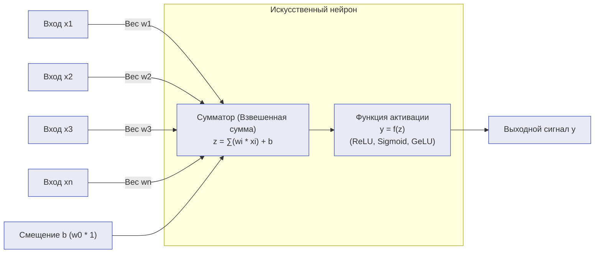

# Практическая работа № 7
## Интеллектуальные системы принятия решений, основанные на нейронных сетях

**Дисциплина:** Искусственный интеллект в профессиональной сфере  
**Выполнил:** студент группы ПИН-б-о-24-1(2), 3 курс  
**ФИО:** Мухамеджанов Эльёр Тимурович  
**Направление подготовки:** 09.03.03 «Прикладная информатика»  
**Профиль:** Разработка программного обеспечения и веб-систем  
**Учебное заведение:** ФГАОУ ВО «Северо-Кавказский федеральный университет»  
**Год:** 2026

---

### Цель занятия
Ознакомиться с основными понятиями, структурой, классификацией и применением искусственных нейронных сетей в интеллектуальных системах принятия решений.

### Вопросы, выносимые на обсуждение
1. Понятие нейронной сети.
2. Структура нейронной сети.
3. Классификация нейронных сетей.
4. Применение нейронных сетей.

---

### Задание 1. Схематичное представление искусственного нейрона

Искусственный нейрон (модель МакКаллока-Питтса / современный персептронный узел) является базовым вычислительным элементом ИНС.

#### Математическое описание:
1. **Взвешенная сумма (индуцированное локальное поле):**
   $$z = \sum_{i=1}^{n} w_i x_i + b = \mathbf{w}^T \mathbf{x} + b$$
   где $x_i$ — входные сигналы, $w_i$ — синаптические веса, $b$ — смещение (bias).
2. **Активация:**
   $$y = f(z)$$
   где $f(z)$ — нелинейная функция активации:
   * $\text{ReLU}(z) = \max(0, z)$ — стандарт для скрытых слоев современных глубоких сетей;
   * $\sigma(z) = \frac{1}{1 + e^{-z}}$ (сигмоида) — для бинарной вероятностной классификации;
   * $\text{Softmax}(z_k) = \frac{e^{z_k}}{\sum_j e^{z_j}}$ — для многоклассового распределения вероятностей.

---

### Задание 2. Классификация нейронных сетей по трем признакам

| Нейронная сеть | 1. Структура сети (Топология) | 2. Особенности моделей нейронов | 3. Особенности обучения |
|---|---|---|---|
| **Многослойный персептрон (MLP)** | Полносвязная (Dense) сеть прямого распространения (Feedforward) без обратных связей. Слои: входной, $N$ скрытых, выходной. | Непрерывные нелинейные нейроны (ReLU, LeakyReLU, Sigmoid). Дифференцируемы на всей числовой оси. | Обучение с учителем (Supervised Learning) методом обратного распространения ошибки (Backpropagation) с градиентным спуском (SGD, Adam). |
| **Свёрточная нейронная сеть (CNN)** | Свёрточные слои (Convolutional) с локальными рецептивными полями и разделяемыми весами ядер (Kernels) + слои субдискретизации (Pooling) + MLP-голова. | Нейроны с локальной связностью, инвариантные к пространственному сдвигу. Активации: ReLU, GELU. | Обучение с учителем на размеченных тензорах (изображения, пространственные сетки) с алгоритмом Backpropagation. |
| **Рекуррентная сеть (RNN / LSTM / GRU)** | Сеть с обратными связями во времени. Наличие скрытого состояния (Hidden State), передающегося от шага $t-1$ к шагу $t$. | Нейроны памяти с вентильными механизмами (Gating mechanisms: входной, забывания, выходной вентили в LSTM). | Обучение с учителем через сквозное разворачивание во времени (BPTT — Backpropagation Through Time). |
| **Самоорганизующаяся карта Кохонена (SOM)** | Однослойная или двухслойная решетка (1D/2D) с латеральным торможением между соседними нейронами. | Нейроны с евклидовой метрикой расстояния до входного вектора весов (Winner-Takes-All). | Обучение без учителя (Unsupervised Learning) по правилу Хебба / конкурентного обучения («победитель забирает всё» и подтягивает соседей). |
| **Сеть Хопфилда (Hopfield Network)** | Симметричная полносвязная рекуррентная сеть с автоассоциативной памятью. $w_{ij} = w_{ji}$, $w_{ii} = 0$. | Биполярные нейроны со ступенчатой пороговой функцией активации ($\pm 1$). | Обучение без учителя / явный расчет синаптических весов по правилу проекции Хебба за один проход ($W = \sum x^k (x^k)^T$). |

---

### Задание 3. Примеры нейронных сетей в профессиональной области (веб-платформы, мультиплеер)

| Нейронная сеть | Область применения в веб-разработке и геймдеве (NecroGames) |
|---|---|
| **LSTM / GRU Network** | **Anti-Cheat & Bot Detection:** анализ временных рядов движения мыши и микропауз между кликами в браузере для выявления ботов-автокликеров. |
| **Многослойный персептрон (MLP)** | **Matchmaking MMR Predictor:** прогноз вероятности победы и подбор сбалансированных команд по набору признаков игроков (пинг, ранг, винрейт). |
| **Автоэнкодер (Autoencoder)** | **Сетевой аномальный детектор:** обнаружение спуфинга пакетов и десинхронизации клиент-серверного протокола без явной разметки читов. |
| **U-Net / Diffusion CNN** | **Генеративный пайплайн ассетов:** процедурная генерация и апскейлинг 2D-спрайтов карт, иконок и текстур для веб-интерфейса. |
| **Deep Q-Network (DQN / PPO)** | **Адаптивные соревновательные ИИ-боты:** обучение агентов оптимальной тактике в браузерных карточных стратегиях против живых игроков. |

---

### Задание 4. Сравнение нейросетевых моделей для решения задачи детекции игровых ботов

* **Задача:** классификация поведения пользователя на клиентской стороне браузерной веб-игры («Живой человек» против «Скриптовый автокликер / Бот») по потоку координат курсора и таймингам WebSocket-сообщений.

| Модель нейронной сети | Достоинства | Недостатки |
|---|---|---|
| **Многослойный персептрон (MLP)** на агрегированных статистических признаках | • Сверхбыстрый инференс ($< 0.1\text{ мс}$ на CPU). • Минимальный размер модели (десятки килобайт), легко запускается прямо в браузере через ONNX.js. • Простота обучения и интерпретации весов. | • Требует трудоемкого ручного проектирования признаков (Feature Engineering: дисперсия, энтропия клика). • Теряет тонкие временные корреляции в последовательности движений. |
| **Одномерная сверточная сеть (1D-CNN)** | • Автоматически извлекает локальные паттерны ускорений мыши независимо от их положения во времени. • Высокая скорость параллельного обучения на GPU. • Меньше параметров, чем у LSTM. | • Ограниченное рецептивное поле: хуже улавливает долгосрочные зависимости длительностью более 5–10 секунд. |
| **Рекуррентная сеть LSTM / GRU** | • Идеально приспособлена для работы с потоковыми временными последовательностями переменной длины. • Учитывает контекст всей игровой сессии. • Наивысшая точность классификации скрытых макросов. | • Медленный последовательный инференс (сложно параллелить). • Выше требования к оперативной памяти сервера. • Склонность к затуханию градиентов на сверхдлинных траекториях. |

#### Итоговый выбор:
Для легковесной клиентской фильтрации в браузере оптимален **MLP на статистических фичах**, а на бэкенд-сервере для окончательной верификации подозрительных игроков развертывается **1D-CNN + GRU модель**.

---

### Вывод
В ходе практической работы № 7 систематизированы фундаментальные принципы построения и топологии искусственных нейронных сетей. Продемонстрировано, как различные архитектуры нейросетей закрывают прикладные задачи интеллектуального анализа данных в профессиональной ИТ-сфере: от легковесных классификаторов прямого распространения до рекуррентных моделей детекции аномалий в сетевых потоках.
