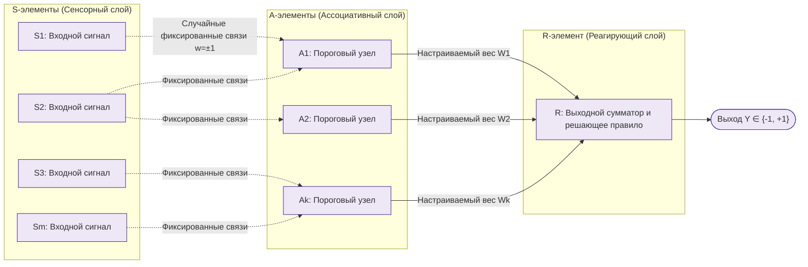

# Практическая работа № 8
## Обучение нейронной сети и релаксационные модели

**Дисциплина:** Искусственный интеллект в профессиональной сфере  
**Выполнил:** студент группы ПИН-б-о-24-1(2), 3 курс  
**ФИО:** Мухамеджанов Эльёр Тимурович  
**Направление подготовки:** 09.03.03 «Прикладная информатика»  
**Профиль:** Разработка программного обеспечения и веб-систем  
**Учебное заведение:** ФГАОУ ВО «Северо-Кавказский федеральный университет»  
**Год:** 2026

---

### Цель занятия
Ознакомиться с основными понятиями, структурой, обучением нейронных сетей методом обратного распространения ошибки и релаксационными моделями.

### Вопросы, выносимые на обсуждение
1. Постановка задачи обучения нейронной сети.
2. Правило обучения Розенблатта.
3. Правило обучения Видроу-Хоффа (Дельта-правило).
4. Многослойные нейронные сети.
5. Алгоритм обратного распространения ошибки (Backpropagation).
6. Нейронная сеть Хопфилда.
7. Нейронная сеть Хемминга.
8. Самоорганизующиеся нейронные сети Кохонена.

---

### Задание 1. Схематичное изображение элементарного персептрона Розенблатта

Классический персептрон Фрэнка Розенблатта (1958 г.) состоит из трех последовательных типов элементов: **S-элементов (сенсорных)**, **A-элементов (ассоциативных)** и **R-элементов (реагирующих / выходных)**.

#### Принцип работы и правило обучения Розенблатта:
* Связи между $S$ и $A$ слоями являются **случайными и фиксированными** (не обучаются).
* Настраиваются только синаптические веса $W_i$ между ассоциативным слоем $A$ и выходным элементом $R$.
* **Правило коррекции весов:** если сеть ошиблась на образце $x$, веса корректируются пропорционально ошибке:
$$W_i(t+1) = W_i(t) + \eta \cdot (d - y) \cdot a_i$$
где $d$ — целевой правильный ответ ($\pm 1$), $y$ — фактический выход сети, $a_i \in \{0, 1\}$ — состояние $i$-го ассоциативного нейрона, $\eta$ — скорость обучения. Если $y = d$, веса не меняются.

---

### Задание 2. Алгоритм обратного распространения ошибки (Backpropagation)

Алгоритм обратного распространения ошибки является ключевым методом обучения многослойных дифференцируемых нейросетей, основанным на минимизации функции потерь с помощью градиентного спуска и правила дифференцирования сложной функции (Chain Rule).

| Этапы алгоритма | Описание шага и математический аппарат |
|---|---|
| **Шаг 1. Инициализация параметров** | Веса $W^{(l)}$ и смещения $b^{(l)}$ всех слоев инициализируются малыми случайными значениями (по методу Xavier/Glorot или He). Скорость обучения $\eta \in (0, 1]$. |
| **Шаг 2. Прямой проход (Forward Pass)** | Входной вектор $x$ подается на сеть и последовательно распространяется от слоя к слою: $$z^{(l)} = W^{(l)} a^{(l-1)} + b^{(l)}, \quad a^{(l)} = f\left(z^{(l)}\right)$$ Все промежуточные пре-активации $z^{(l)}$ и пострезультаты $a^{(l)}$ кэшируются в памяти. |
| **Шаг 3. Вычисление функции потерь (Loss Calculation)** | На выходном слое $L$ сравнивается предсказанный выход $\hat{y} = a^{(L)}$ с истинным вектором меток $y$. Вычисляется скалярная ошибка (MSE или кросс-энтропия): $$J(W, b) = -\sum_{k} \left[ y_k \ln \hat{y}_k + (1 - y_k) \ln (1 - \hat{y}_k) \right]$$ |
| **Шаг 4. Расчет локальной ошибки выходного слоя** | По правилу цепочки вычисляется градиент ошибки по активациям выходного слоя: $$\delta^{(L)} = \frac{\partial J}{\partial z^{(L)}} = \frac{\partial J}{\partial a^{(L)}} \odot f'\left(z^{(L)}\right) = (\hat{y} - y)$$ |
| **Шаг 5. Обратный проход ошибки (Backward Pass)** | Ошибка рекурсивно пробрасывается от выходного слоя к входным через транспонированные матрицы весов: $$\delta^{(l)} = \left( (W^{(l+1)})^T \delta^{(l+1)} \right) \odot f'\left(z^{(l)}\right)$$ |
| **Шаг 6. Вычисление градиентов по весам и сдвигам** | Накапливаются частные производные потерь по каждому параметру сети: $$\frac{\partial J}{\partial W^{(l)}} = \delta^{(l)} (a^{(l-1)})^T, \quad \frac{\partial J}{\partial b^{(l)}} = \delta^{(l)}$$ |
| **Шаг 7. Коррекция параметров (Optimizer Update)** | Веса обновляются в сторону, противоположную вектору градиента: $$W^{(l)} \leftarrow W^{(l)} - \eta \frac{\partial J}{\partial W^{(l)}}, \quad b^{(l)} \leftarrow b^{(l)} - \eta \frac{\partial J}{\partial b^{(l)}}$$ (Или применяются адаптивные моменты Adam/RMSprop). |
| **Шаг 8. Проверка критерия останова** | Проверяется эпоха обучения: если ошибка на валидационной выборке стабилизировалась или градиент $\|\nabla J\| < \varepsilon$, обучение останавливается; иначе переход к Шагу 2. |

---

### Задание 3. Примеры нейронных сетей в профессиональной области

| Нейронная сеть | Область применения в веб-системах и сетевых играх |
|---|---|
| **Fully Connected MLP (Backpropagation)** | Оценка пинга и прогнозирование сетевых дропов пакетов по скользящему окну телеметрии. |
| **Сеть Хемминга (Hamming Net)** | Классификация дискретных бинарных паттернов нажатия клавиш для идентификации игрового стиля и защиты аккаунта. |
| **Сеть Хопфилда (Hopfield Net)** | Ассоциативное восстановление искаженных или частично утерянных сетевых пакетов WebSocket в игре. |
| **Сеть Кохонена (SOM)** | Кластеризация игроков по стилям ведения боя (агрессивный, выжидающий, пассивный) для балансировки сессий. |

---

### Задание 4. Сравнение релаксационных нейронных сетей

Релаксационные нейронные сети — это динамические рекуррентные системы, в которых после подачи входного сигнала запускается итерационный процесс релаксации (пересчета состояний), пока система не сойдется к локальному минимуму энергетической функции (аттрактору).

| Сеть | Принцип и математическое описание | Достоинства | Недостатки |
|---|---|---|---|
| **Сеть Хопфилда (Hopfield Network)** | Однослойная симметричная автоассоциативная сеть. Каждый нейрон соединен со всеми остальными ($w_{ij} = w_{ji}, w_{ii} = 0$). Имеет энергетическую функцию Ляпунова: $E = -\frac{1}{2}\sum \sum w_{ij} s_i s_j$. Динамика сети всегда минимизирует $E$. | • Идеальное восстановление эталонных образов по зашумленным или неполным данным. • Простота обучения по формуле проекций Хебба. • Гарантированная сходимость к устойчивому состоянию. | • Ограниченная емкость памяти: максимум $\approx 0.14 \cdot N$ эталонов (при превышении возникают ложные аттракторы / паразитные состояния). • Не решает задачи сложных функциональных преобразований. |
| **Сеть Хемминга (Hamming Network)** | Двухслойная классифицирующая сеть. 1-й слой вычисляет корреляцию входа с эталонами (расстояние Хемминга), 2-й слой (Maxnet) с латеральным торможением определяет победителя по принципу «победитель забирает всё». | • Емкость памяти не ограничена числом нейронов (не возникают паразитные состояния, в отличие от Хопфилда). • Требует меньше межнейронных связей ($O(M \cdot N)$). • Высокая скорость сходимости слоя Maxnet. | • Работает исключительно с бинарными/биполярными векторами фиксированной длины. • Плохо масштабируется на непрерывные аналоговые сигналы. |
| **Машина Больцмана (Boltzmann Machine)** | Стохастическая релаксационная сеть со скрытыми и видимыми нейронами. Переход нейрона в состояние $+1$ осуществляется с вероятностью, описываемой распределением Больцмана: $P(s_i=1) = \frac{1}{1 + e^{-\Delta E_i / T}}$. | • Способна выходить из локальных минимумов за счет термического стохастического шума (метод имитации отжига). • Формирует вероятностное внутреннее представление данных. | • Экстремально медленный процесс обучения (требует сотен шагов сэмплирования Гиббса до установления термодинамического равновесия). |

---

### Вывод
В ходе практической работы № 8 изучены ключевые концепции обучения ИНС: от порогового правила персептрона Розенблатта до дифференцируемого метода обратного распространения ошибки (Backpropagation). Проанализирована специфика релаксационных динамических систем (Хопфилда, Хемминга, Больцмана), основанных на схождении к устойчивым энергетическим аттракторам, что демонстрирует их потенциал в задачах ассоциативной памяти и восстановления искаженных данных.
