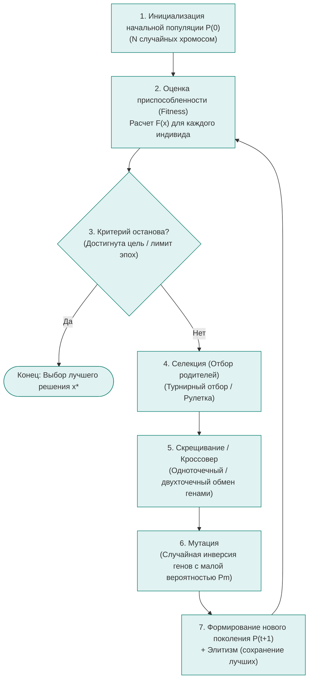

# Практическая работа № 9
## Генетические алгоритмы

**Дисциплина:** Искусственный интеллект в профессиональной сфере  
**Выполнил:** студент группы ПИН-б-о-24-1(2), 3 курс  
**ФИО:** Мухамеджанов Эльёр Тимурович  
**Направление подготовки:** 09.03.03 «Прикладная информатика»  
**Профиль:** Разработка программного обеспечения и веб-систем  
**Учебное заведение:** ФГАОУ ВО «Северо-Кавказский федеральный университет»  
**Год:** 2026

---

### Цель занятия
Ознакомиться с основными понятиями, структурой, классификацией и практическим применением генетических и эволюционных алгоритмов в задачах оптимизации.

### Вопросы, выносимые на обсуждение
1. Основные понятия и биологические аналогии генетических алгоритмов.
2. Пример работы простого генетического алгоритма (SGA).
3. Достоинства и недостатки генетических алгоритмов.
4. Применение генетических алгоритмов.

---

### Задание 1. Схематичное изображение работы простого генетического алгоритма

Генетический алгоритм (Genetic Algorithm, GA) моделирует процесс естественного отбора Ч. Дарвина: выживание наиболее приспособленных особей, рекомбинацию хромосом и мутационную изменчивость.

---

### Задание 2. Этапы разработки генетического алгоритма

| Этапы разработки | Описание шага и проектные решения |
|---|---|
| **Шаг 1. Кодирование решений (Представление хромосомы)** | Определение структуры генотипа. Выбирается способ представления параметров: двоичный вектор (бинарная строка), целочисленный массив или вещественные числа (Real-valued GA). Например, для карточной колоды: вектор индексов карт длины $K$. |
| **Шаг 2. Разработка фитнес-функции (Fitness Function)** | Формализация целевого функционала $F(x) \ge 0$, сопоставляющего каждому кандидату его скалярную приспособленность. Чем лучше решение оптимизационной задачи, тем выше значение $F(x)$. |
| **Шаг 3. Инициализация начальной популяции** | Генерация $N$ особей (типично $N \in [50, 500]$). Применяется равномерное случайное распределение либо эвристический засев для ускорения начальной сходимости. |
| **Шаг 4. Выбор оператора селекции (Selection)** | Определение вероятности участия особи в размножении: метод рулетки (Roulette Wheel), турнирная селекция (Tournament Selection) или ранговый отбор. Турнирный отбор предпочтителен, так как легко параллелится и не подвержен преждевременной стагнации. |
| **Шаг 5. Выбор генетических операторов (Кроссовер и Мутация)** | • **Кроссовер ($P_c \approx 0.7..0.9$):** моделирует скрещивание родителей с обменом участками хромосом. • **Мутация ($P_m \approx 0.005..0.05$):** случайная модификация отдельных генов для предотвращения застревания в локальных оптимумах. |
| **Шаг 6. Настройка стратегии смены поколений и элитизма** | Внедрение механизма элитизма (Elitism): безусловное копирование $1..3$ лучших особей текущего поколения в следующее без изменений, что гарантирует монотонное неухудшение рекорда приспособленности. |
| **Шаг 7. Определение критериев останова и валидация** | Условие завершения: достижение требуемого порога фитнеса $F(x) \ge F_{\text{target}}$, отсутствие улучшений в течение $K$ поколений (стагнация) или исчерпание лимита эпох. |

---

### Задание 3. Задачи из профессиональной области (мультиплеерный веб-геймдев), решаемые генетическим алгоритмом

В области проектирования соревновательных браузерных веб-игр (платформа NecroGames) генетические алгоритмы решают сложнейшие задачи нелинейной дискретной оптимизации:

1. **Автоматическая автобалансировка характеристик карт и артефактов (Game Economy & Card Balancing):**
   * *Хромосома:* вектор параметров карт (урон, стоимость маны, здоровье, шанс критического удара).
   * *Фитнес-функция:* минимизация отклонения винрейта колод от идеальных 50% в серии сотен тысяч симулированных микропартий.
   * *Результат:* устранение «имбалансных» карт до релиза обновления на продакшн.
2. **Процедурная генерация сбалансированных карт и подземелий (Dungeon Layout PCG):**
   * *Хромосома:* матрица расположения комнат, дверей, лута и спавнов монстров.
   * *Фитнес-функция:* максимизация разнообразия маршрутов при обязательном условии топологической проходимости и равенства расстояний до ключевых ресурсов для обеих команд.
3. **Оптимизация распределения игровых комнат по серверам (Cluster Load Balancing):**
   * Распределение $M$ активных комнат с разными требованиями по CPU/памяти по пулу облачных виртуальных серверов с минимальной стоимостью аренды и пинга.

---

### Задание 4. Достоинства и недостатки эволюционных алгоритмов

| Эволюционный алгоритм | Ключевые отличия от других подходов | Достоинства | Недостатки |
|---|---|---|---|
| **Генетические алгоритмы (Genetic Algorithms, GA)** | Оперируют преимущественно строковыми или бинарными хромосомами фиксированной длины; основной упор делается на оператор кроссовера. | • Универсальность: не требуют информации о производной целевой функции. • Эффективный глобальный поиск в многоэкстремальных пространствах. • Легкая параллелизация на кластерах. | • Чувствительность к подбору гиперпараметров ($P_c, P_m, N$). • Риск преждевременной сходимости (Genetic Drift). • Трудность учета жестких ограничений. |
| **Генетическое программирование (Genetic Programming, GP)** | Особи представлены в виде **синтаксических деревьев программ (AST)** переменного размера, а не плоских векторов. | • Способно автоматически генерировать исполняемый программный код, формулы и алгоритмы без участия программиста. • Высокая гибкость структуры. | • Проблема чрезмерного разрастания деревьев (Code Bloat). • Высокая вычислительная стоимость выполнения кода особей на каждом поколении. |
| **Эволюционные стратегии (Evolutionary Strategies, ES)** | Ориентированы на непрерывную оптимизацию вещественных чисел; ключевым оператором является адаптивная гауссова мутация. | • Отличная скорость локальной сходимости в задачах непрерывной математической оптимизации. • Самоадаптация шага мутации ($\sigma$). | • Менее эффективны в дискретных комбинаторных задачах. • Склонны застревать в оврагах целевой функции без должной регуляризации. |
| **Дифференциальная эволюция (Differential Evolution, DE)** | Мутация осуществляется через взвешенную разность векторов случайных особей текущей популяции ($v = x_1 + F \cdot (x_2 - x_3)$). | • Экстремально простая реализация и минимум настраиваемых параметров. • Высокая устойчивость и точность в непрерывных пространствах. | • Не предназначена напрямую для дискретных и графовых структур данных (требует кодировок). |

---

### Вывод
В ходе практической работы № 9 изучены методологические основы генетических и эволюционных алгоритмов поиска оптимума. Установлено, что стохастическая эволюционная оптимизация превосходно справляется с NP-трудными комбинаторными задачами игрового геймдизайна (процедурный баланс сущностей, процедурная генерация уровней), для которых аналитический расчет невозможен из-за колоссальной размерности пространства состояний.
